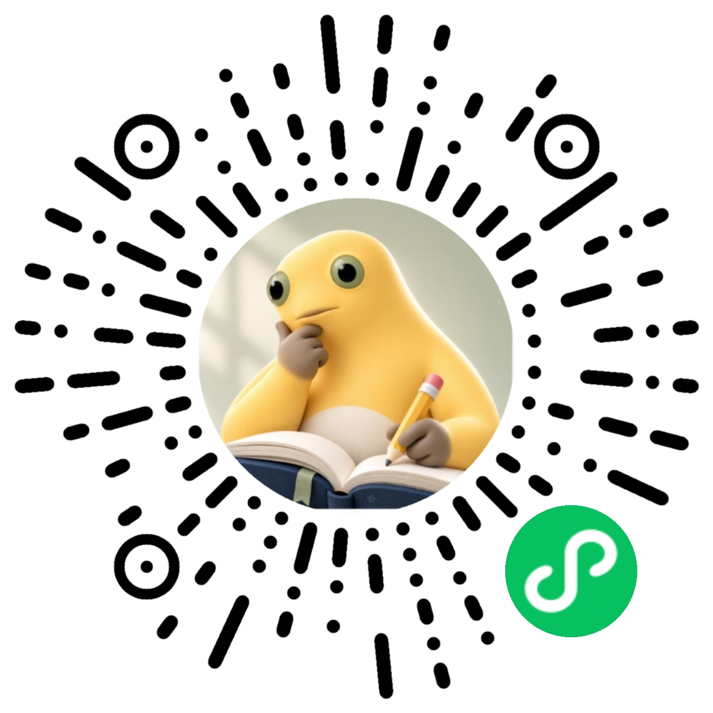
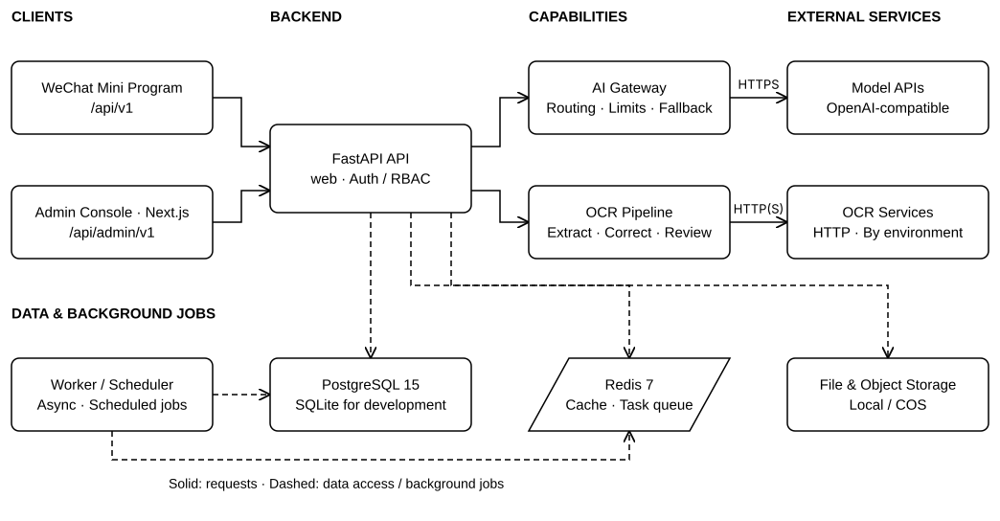

<p align="center">
  
</p>

<h1 align="center">MemoGrad · 408AI Study Platform</h1>

<p align="center">
  AI-assisted exam practice, question governance, and learning operations for the Chinese CS 408 postgraduate exam
</p>

<p align="center">
  <a href="./README.md">简体中文</a>
  <span>·</span>
  <a href="./README.en-US.md">English</a>
</p>

<p align="center">
  <a href="https://github.com/ly9098-prog/postgraduate-exam-AI/actions/workflows/ci.yml"></a>
  <a href="https://github.com/ly9098-prog/postgraduate-exam-AI/actions/workflows/reliability.yml"></a>
  
  
  
  
  
  
</p>

<p align="center">
  
</p>

<h2 align="center">✨ Highlights</h2>

<div align="center">
  <table>
    <tr><td align="center">🎯<br/><strong>Learning Loop</strong><br/><sub>Practice, review, reporting</sub></td><td align="center">🧠<br/><strong>AI Governance</strong><br/><sub>Quota, health, limits</sub></td><td align="center">📚<br/><strong>Question Governance</strong><br/><sub>Versions, review, graphs</sub></td><td align="center">🚀<br/><strong>Production Ready</strong><br/><sub>Docker, queues, observability</sub></td></tr>
  </table>
</div>

## Contents

- [Overview](#overview)
- [Architecture](#architecture)
- [Capabilities](#capabilities)
- [Quick Start](#quick-start)
- [API Overview](#api-overview)
- [Quality Gates](#quality-gates)
- [Production Deployment](#production-deployment)
- [Security Notes](#security-notes)
- [FAQ](#faq)
- [License](#license)

## Overview

MemoGrad is a complete postgraduate-exam study platform that combines a WeChat Mini Program, an admin console, and a FastAPI backend. It covers practice, wrong-answer remediation, spaced review, question versioning, OCR/AI ingestion, formulas, exams, learning analytics, RBAC, and asynchronous operations.

| Module | Status | Description |
| --- | --- | --- |
| WeChat Mini Program | In production | Practice, review, wrong answers, formulas, exams, Pomodoro, exports |
| Admin Console | In production | Question governance, import review, RBAC, AI/OCR/vector settings, audit logs |
| Backend API | In production | Public/admin API layers, Redis queue, AI gateway, OCR pipeline |
| Production Deployment | In production | Docker Compose, Nginx, PostgreSQL, Redis, backup tasks |

## Architecture

<p align="center">
  
</p>

The backend is split by `PROCESS_ROLE`:

| Role | Responsibility |
| --- | --- |
| `web` | HTTP API, authentication, business APIs, OCR gateway |
| `worker` | Async tasks, pipeline dispatcher, AI prewarm, reaper |
| `scheduler` | Scheduled jobs, cleanup, reminders, export processing |
| `all` | Single-process mode, development only |

## Capabilities

### Mini Program

- Guest browsing and trial practice with public subjects and formulas
- Practice, wrong-answer management, spaced review, and mastery tracking
- 408 exam mode, formula cards, function graphs, Pomodoro, and PDF export
- Learning reports, trends, and AI-assisted explanations

### Admin Console

- Question versions, publication, image management, and exam papers
- OCR/AI/text/CSV/batch image ingestion with human review
- Formula cards, categories, graph specs, knowledge graphs, and quality gates
- RBAC, audit logs, dashboards, and system task operations

### Backend

- FastAPI with public and admin API layers and isolated JWT domains
- SQLAlchemy 2.0 async ORM, Alembic migrations, PostgreSQL and SQLite support
- Redis-backed durable task queue with web, worker, and scheduler roles
- OCR import pipeline with quality gates, correction, and review workflow
- Central AI gateway with concurrency, quotas, health state, and circuit controls

## Quick Start

### Requirements

| Component | Version | Purpose |
| --- | --- | --- |
| Python | 3.11+ | Backend API, worker, scheduler |
| PostgreSQL | 15 / pgvector | Production data and vector search |
| Redis | 7 | Cache and durable task queue |
| Node.js | 22 | Admin console and tooling |
| WeChat Developer Tools | Latest | Mini program build and device testing |

### Backend

```bash
cd backend
python -m venv .venv
source .venv/bin/activate
python -m pip install --upgrade pip
pip install -r requirements.txt
cp .env.example .env
uvicorn app.main:app --reload --host 0.0.0.0 --port 8000
```

### Admin Console

```bash
cd admin-frontend
npm ci
cp .env.example .env.local
npm run dev
```

### Mini Program

```bash
cd miniprogram
npm install
node tests/test-config-resolution.js
node tests/test-render-invariant.js
```

Open the project in WeChat Developer Tools for simulator and device verification.

## API Overview

| API | Prefix | Purpose |
| --- | --- | --- |
| Public API | `/api/v1` | Authentication, practice, review, wrong questions, formulas, exams |
| Admin API | `/api/admin/v1` | Questions, imports, formulas, RBAC, AI/OCR/vector settings, audit |
| Health | `/health`, `/health/live`, `/health/ready` | Process and dependency probes |

For detailed contracts, see `docs/backend/API_SPEC.md` and `docs/admin/ADMIN_API_SPEC.md`.

## Quality Gates

```bash
cd backend
python -m compileall -q app
ruff check app/
python -m pytest tests/ -q

cd ../admin-frontend
npm run check
```

GitHub Actions runs the main `CI` workflow and a separate `Reliability Gate` covering backend integration, Alembic migration, Redis/PostgreSQL, OpenAPI contracts, and admin builds.

## Production Deployment

Production uses `deploy/docker-compose.prod.yml` with FastAPI, a Redis worker, a scheduler, Next.js admin, Nginx, PostgreSQL, Redis, and backup services.

High-level deployment order:

```bash
rsync -az --exclude-from=".deployignore" ./ server:/opt/22408-ai/
cd /opt/22408-ai
set -a; source backend/.env; set +a
bash deploy/scripts/deploy.sh update
bash deploy/scripts/deploy.sh status
```

Use `deploy/scripts/deploy.sh migrate` only after confirming a schema migration. The production profile must use `APP_ENV=production` and `DEPLOYMENT_PROFILE=cloud_api`.

## Security Notes

- Never commit real `.env` files, credentials, tokens, certificates, databases, logs, backups, or runtime artifacts.
- AI credentials are stored encrypted in `admin_ai_model_configs`, not as environment variables.
- Public and admin JWT domains are isolated; RBAC and audit logging apply to admin operations.
- OCR/AI imports require human review before entering the question bank.
- Cross-environment data synchronization must match records by `sync_uuid`; do not update production rows by numeric ID.

## FAQ

### Backend refuses to start in local development

The code defaults to production. Set:

```env
APP_ENV=development
```

### Mini Program cannot reach a local API

Use a LAN address, HTTPS test domain, or production domain for real devices; configure the domain in the WeChat mini program allowlist.

### OCR is unavailable

Check `OCR_ENABLED`, `OCR_EXECUTION_BACKEND`, `OCR_REMOTE_URL`, token/network access, and the deployment profile. Local GPU OCR uses the Windows PaddleX HTTP service; WSL CUDA is not available.

## License

This project is released under [PolyForm Noncommercial 1.0.0](LICENSE). Personal study, research, testing, and noncommercial organization use are permitted. Commercial deployment, commercial integration, paid service redistribution, and commercial redistribution are not licensed.

Copyright © 2026 [ly9098-prog](https://github.com/ly9098-prog).

Keep the license and copyright notice when reusing or redistributing.

<div align="center">
  <sub>MemoGrad · A study and question-governance platform for the CS 408 exam</sub>
</div>
